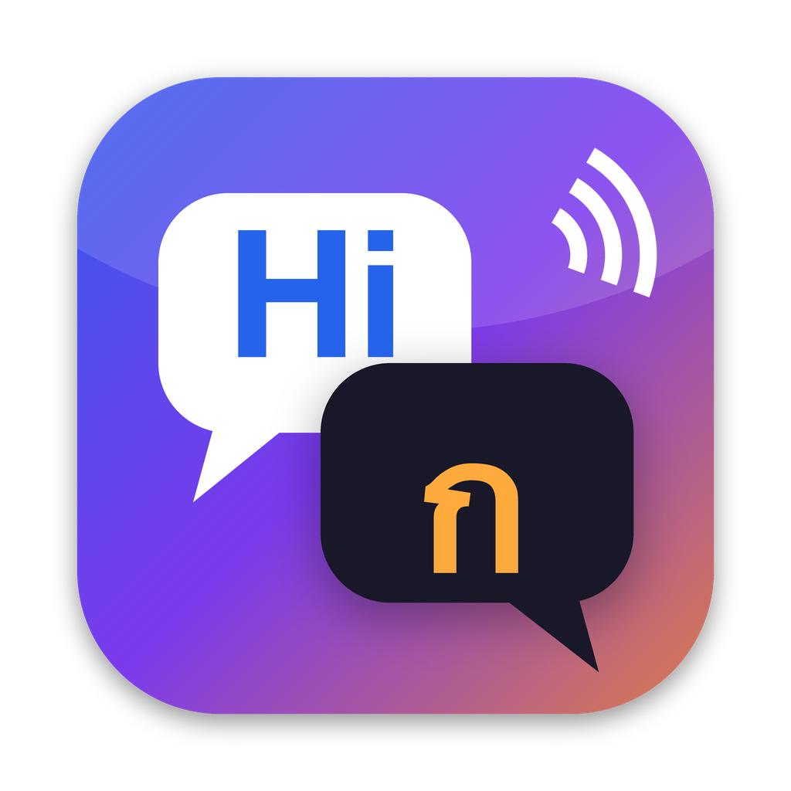

# Dolmetscher EN ⇄ TH

Hands-free speech interpreter for macOS: just talk. English is translated into Thai and Thai into English, and the translation is spoken aloud right away. The engine **detects the language by itself**, so there are no buttons to switch.

- Speech recognition: [faster-whisper](https://github.com/SYSTRAN/faster-whisper), local on the Mac, on the Apple GPU (Metal) when available, otherwise CPU. Models: `small` (fast), `medium` (default), `best` (medium for Thai + large-v3-turbo for English, better with accents; ~1.6 GB extra download on first use)
- Translation: Google Translate web endpoint (unofficial, falls back to MyMemory). Needs internet
- Speech output: natural Microsoft neural voices via the unofficial [edge-tts](https://github.com/rany2/edge-tts) library (Thai: Niwat / Premwadee, English: Ava). The translated text is sent to Microsoft for this. Falls back to macOS voices (`say`) when offline or if that service stops working (`--tts say` forces it)
- Latency: roughly 3–5 s after the end of each sentence (recognition ~1.5–3 s on the GPU, translation ~1.5 s, voice ~1.5 s)
- Quiet speech: Silero voice activity detection plus input gain, so soft voices are picked up too
- Only English and Thai: other languages (and noise) are ignored. An Auto / EN / TH picker locks the language if needed
- Log for troubleshooting: `~/Library/Logs/Dolmetscher/engine.log`

## Voice commands

Talk to it like Siri: start with **"Translator, …"** (or "Hey translator, …"). Commands are never translated.

| Say | Effect |
|---|---|
| Translator, pause / resume | stop translating / start again (it keeps listening for commands) |
| Translator, repeat | say the last translation again |
| Translator, slower / faster | speaking rate |
| Translator, louder / quieter | volume |
| Translator, Thai only / English only / auto | lock the language or detect automatically |
| Translator, female voice / male voice | Thai voice and politeness particle (ค่ะ / ครับ) |
| Translator, English off / Thai off | that language is only shown, not translated or spoken (e.g. you speak English, only your partner's Thai is translated) |
| Translator, English on / Thai on / translate both | turn a direction back on |
| Translator, clear | clear the conversation |
| Translator, help | list the commands |
| Translator. *(pause)* … | answers "Yes?" and takes the next sentence as a command |

Commands only control the app. General questions (weather, facts) are not supported, since that would need an LLM.

## Mac app

Requirements: macOS 14+, Xcode Command Line Tools, `brew install ffmpeg`, Python 3.

```bash
./build.sh --install
```

This creates a Python environment under `~/Library/Application Support/Dolmetscher/venv` with the pinned versions from `requirements.txt` (via `uv` if installed, else `pip`; re-running the script brings an existing environment back to those versions), downloads the `medium` and `small` models (once, ~2 GB) and installs `~/Applications/Dolmetscher.app`. Use an existing Python instead: `DOLMETSCHER_PYTHON=/path/to/python ./build.sh --install` (nothing is installed into it; it needs the packages from `requirements.txt`).

Each rebuild is signed ad hoc, so macOS may ask for microphone access again. To avoid that, sign with a stable identity: `DOLMETSCHER_SIGN_IDENTITY="Dolmetscher Dev" ./build.sh --install` (see [CONTRIBUTING.md](CONTRIBUTING.md#stable-code-signing)).

Open the app, press **Start** (or the space bar) and allow microphone access.

If the Thai voice is missing: System Settings → Accessibility → Spoken Content → System Voice → Manage Voices → Thai (Kanya).

## Terminal only

```bash
pip install -r requirements.txt
python3 dolmetscher.py            # --model base|small|medium  --polite krub|ka  --mic 0
```

## Browser version

Live: https://pschmetzer.github.io/en-th-dolmetscher/ — `index.html` is the **Web Lite** version: a single file, no build step, no external scripts. It uses Chrome's Web Speech API, so you pick the language yourself (buttons / keys `E`, `T`). The Mac app is better: automatic language detection, voice commands in both languages, better recognition.

Web Lite features:
- Per-direction switches "Translate EN→TH" / "Translate TH→EN". When a direction is off, only the recognized text is shown (no translation, no speech).
- Voice commands in EN mode, at the start of a sentence, never translated: "Translator pause / resume / repeat / slower / faster".
- Partner view (`P`): full screen, only the latest translation in huge type (`Esc` closes).
- Dark/light theme follows the system; works at phone width.
- Keys: `E` English, `T` Thai, `Space` stop, `P` partner view, `Esc` close it.
- Translation: Google endpoint, MyMemory as fallback. Error or quota messages are never shown or spoken as a translation.

Serve it locally with `python3 -m http.server` and open it in Chrome.

## Notes

- Laptop speakers: the microphone is muted while the translation is playing, so the engine doesn't translate its own voice.
- `--polite krub|ka` picks the Thai politeness particle (ครับ/ค่ะ) and the pronoun (ผม/ฉัน).

## Uninstall

```bash
rm -rf ~/Applications/Dolmetscher.app
rm -rf ~/Library/Application\ Support/Dolmetscher   # Python environment and settings
rm -rf ~/Library/Logs/Dolmetscher
rm -rf ~/.cache/huggingface/hub/models--Systran--faster-whisper-*   # Whisper models (shared with other apps using faster-whisper)
```

Microphone permission: System Settings → Privacy & Security → Microphone, or `tccutil reset Microphone io.github.dolmetscher.en-th`.

## Contributing

See [CONTRIBUTING.md](CONTRIBUTING.md). Tests: `pip install -r requirements-dev.txt && pytest` (no models, network or microphone needed).

## License

MIT License. Dependencies keep their own licenses; notably [edge-tts](https://github.com/rany2/edge-tts) is LGPL-3.0. It is only installed as a dependency, not included in this repository or the app bundle.
