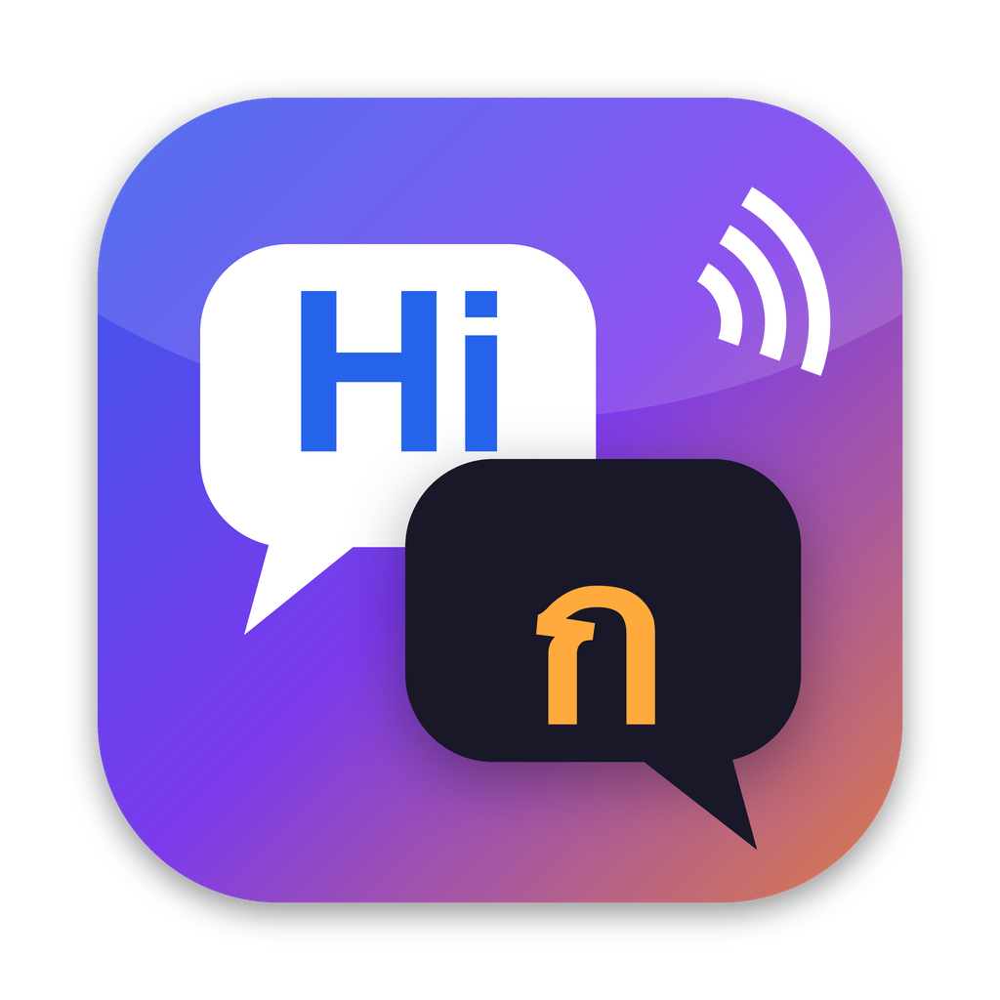

# Dolmetscher EN ⇄ TH

A hands-free speech interpreter: just talk. What you say is translated into your partner's language and spoken aloud right away, and their answer comes back in yours. The app **detects which of the two languages is being spoken**, so there are no buttons to switch. English ⇄ Thai is the default, but you can pick any pair of [19 languages](#languages).

| Platform | What it is | Speech recognition | Translation |
|---|---|---|---|
| **Mac** (Apple Silicon, macOS 14+) | Full app with menu bar, voice commands, voice profiles, Claude translation | local (Whisper) | online (Google, MyMemory or Claude) |
| **iPhone / iPad** (iOS 26+) | Native companion app with widgets, built yourself in Xcode | on the device (Apple, optionally Whisper) | on the device (Apple), online only if you allow it |
| **Browser** (Chrome) | [Web Lite](https://pschmetzer.github.io/en-th-dolmetscher/): one HTML file, installable as an app (PWA) | browser service (Google in Chrome) | online (Google, MyMemory) |

**Privacy in one paragraph.** There are no accounts, no telemetry and no server of our own. On the Mac, audio never leaves the computer: recognition runs locally and only the recognised *text* is sent for translation (Google, fallback MyMemory, or Claude if you turned it on) and the translated text for the natural voice (Microsoft). On the iPhone, recognition and – once the offline language packs are installed – translation run entirely on the device; online translation is off by default. Flashcards (iPhone, browser) are stored only on your device. The browser version relies on the browser's speech service, which sends audio to Google (Chrome). Voice profiles and the conversation history (Mac: off by default; iPhone: kept 30 days by default, adjustable) stay on your device. Details per platform: [docs/DATENSCHUTZ.md](docs/DATENSCHUTZ.md) (German).

Current version: 1.2 (single source: `version` in `pyproject.toml`). What changed since: [CHANGELOG.md](CHANGELOG.md).

- [Features at a glance](#features-at-a-glance)
- [Install on the Mac](#install-on-the-mac)
- [iPhone app](#iphone-app)
- [Browser version](#browser-version-web-lite)
- [Languages](#languages)
- [Using the Mac app](#using-the-mac-app) · [Voice commands](#voice-commands) · [Voice profiles](#voice-profiles) · [Troubleshooting](#troubleshooting)
- [For developers](#for-developers)

## Features at a glance

| Feature | Mac | iPhone / iPad | Browser |
|---|:-:|:-:|:-:|
| Automatic detection of who speaks which language | ✓ | ✓ | – (you tap the side) |
| 19 languages, any pair | ✓ | ✓ | ✓ |
| Translation on the device, without internet | ✓ (Apple, macOS 26.4+, as fallback) | ✓ (Apple, default) | – |
| Claude translation (optional, paid) | ✓ | – | – |
| Back-translation to check the meaning | ✓ (online, optional) | ✓ (on the device) | – |
| Conversation mode (split screen, partner half turned around) | – | ✓ | – |
| Partner view with large type | ✓ | ✓ | ✓ |
| Answer cards (yes / no / don't know / number) | – | ✓ | ✓ (yes / no) |
| Phrasebook with 51 scenario packs, cultural notes, important sentences first | ✓ | ✓ | ✓ (also offline) |
| Learning mode (flashcards) | – | ✓ | ✓ |
| Voice commands (“Translator, …”) | ✓ | ✓ | ✓ (subset) |
| Push-to-talk | ✓ | ✓ | ✓ |
| Emergency screen and emergency card | – | ✓ | – |
| Widgets, Live Activity, Control Center button | – | ✓ | – |
| Voice profiles (who is speaking) | ✓ | – | – |
| Choice of output device (speaker / headphones) | ✓ | – | – |
| Conversation history | ✓ (off by default) | ✓ (30 days by default) | – (copy or save by hand) |

## Install on the Mac

There is no ready-made download yet; you build the app from source. That takes one command.

1. Requirements: a Mac with **Apple Silicon** (M1 or later, no Intel), macOS 14 or newer, the Xcode Command Line Tools (`xcode-select --install`) and [uv](https://docs.astral.sh/uv/) (`brew install uv` or the installer from astral.sh). **Homebrew Python and ffmpeg are not needed.**
2. Get the code: `git clone https://github.com/Pschmetzer/en-th-dolmetscher.git` (or “Code → Download ZIP” on GitHub) and open the folder in Terminal.
3. Build and install:

   ```bash
   ./build.sh --install
   ```

   This installs `~/Applications/Dolmetscher.app`. On the build Mac it also prepares the Python environment and downloads the speech models (`medium`, `small` and the Thai model, about 3.5 GB once), so the app starts straight away.
4. Open the app, press **Start** (or the space bar) and allow microphone access.

**First start on another Mac.** The app bundle is self-contained: it ships `uv` and a lock file, but no Python. If you copy the app to a Mac without that environment, it opens a **setup screen** on first start. It shows the download size (~0.4 GB for the environment, ~3.5 GB including the default models) and your free disk space, then downloads its own Python 3.12, installs the locked packages (hash-checked, wheels only) into `~/Library/Application Support/Dolmetscher/` and finally the speech models, each with a progress bar. You can cancel and retry; it says clearly when there is no internet, not enough space or when the Mac is an Intel Mac. After an app update with changed packages it sets the environment up again by itself; the settings also have a button to set it up anew.

**Microphone permission after rebuilds.** Each rebuild is signed ad hoc, so macOS may ask for the microphone again. Sign with a stable identity to avoid that: `DOLMETSCHER_SIGN_IDENTITY="Dolmetscher Dev" ./build.sh --install` ([how to create one](CONTRIBUTING.md#stable-code-signing)).

**Missing Thai system voice** (only used when the online voice is unavailable): System Settings → Accessibility → Spoken Content → System Voice → Manage Voices → Thai (Kanya).

More build options (extra models with `DOLMETSCHER_MODELS="medium small th best"`, skipping models with `DOLMETSCHER_SKIP_MODELS=1`, using another Python with `DOLMETSCHER_PYTHON`, signed release builds): [CONTRIBUTING.md](CONTRIBUTING.md#release-build).

### Uninstall

```bash
rm -rf ~/Applications/Dolmetscher.app
rm -rf ~/Library/Application\ Support/Dolmetscher   # Python environment (incl. its own Python), settings, profiles, history
rm -rf ~/Library/Logs/Dolmetscher
rm -rf ~/.cache/huggingface/hub/models--Systran--faster-whisper-*   # Whisper small/medium (shared with other apps using faster-whisper)
rm -rf ~/.cache/huggingface/hub/models--Vinxscribe--biodatlab-whisper-th-medium-faster   # Thai model
rm -rf ~/.cache/huggingface/hub/models--mobiuslabsgmbh--faster-whisper-large-v3-turbo   # only if you used --model best
```

Microphone permission: System Settings → Privacy & Security → Microphone, or `tccutil reset Microphone io.github.dolmetscher.en-th`.

## iPhone app

A native SwiftUI app in `ios/` with the same idea: press Start and just talk. It does not use the Python engine.

- **Recognition** on the device with Apple's speech recognition. Optionally **Whisper** (WhisperKit): switch it on in the settings and download a model once (only when you tap download; size and Wi-Fi hint are shown). Without a model the app falls back to Apple's recognition.
- **Translation** on the device with Apple's Translation framework once the offline language packs for your pair are installed. If a pack is missing, it can use Google Translate (fallback MyMemory) – but only if you turn on **“Online translator as fallback”** (off by default).
- **Voice** from the iOS system voices.
- **Conversation mode**: split screen for a table conversation, the partner's half is turned around; each half shows the conversation in its own language. **Answer cards** (yes, no, don't know, number) let the other person answer without speaking.
- **Phrasebook** with the 51 scenario packs of the Mac app: each pack shows a short cultural note, important sentences (allergies, emergency) are marked red and come first. Sentences that match the phrasebook use the checked version (“phrasebook first”).
- **Learning mode**: favourites and translated sentences become flashcards, stored only on the device.
- **Widgets**: quick phrases on the home screen, a “Start interpreter” button for Control Center, lock screen and Action button, and a **Live Activity** (off by default on a new install; it never shows sentences while the iPhone is locked).
- **iPad**: conversation on the left, tools (phrasebook, destinations, emergency, Baht) on the right.
- Also: back-translation and transliteration, emergency screen and allergy card, “Help now” with your location, taxi destinations (with business card scan), text from photos, Baht calculator, Siri shortcuts, Face ID lock for the history, “Delete all data”.
- **Interface** in 10 languages (de, en, th, es, fr, ja, ko, zh-Hans, vi, id; the 7 newest are machine-translated and not yet reviewed).

Needs iOS 26 and Xcode 26 or newer. There is no App Store version yet: build it yourself with your own Apple ID – step by step in [ios/README.md](ios/README.md).

## Browser version (Web Lite)

Live: https://pschmetzer.github.io/en-th-dolmetscher/ — `index.html` is a single file, no build step, no external scripts. Same 19 languages as the apps (English ⇄ Thai by default). It uses the browser's Web Speech API (best in Chrome; Firefox has no speech recognition), so you pick who speaks yourself (buttons or keys `E` for your language, `T` for the partner's). The Mac app is better: automatic language detection, voice commands in both languages, better recognition.

- Asks for consent once before the microphone starts for the first time.
- Per-direction switches “Translate A→B” / “Translate B→A” (named after the chosen languages): a switched-off direction is only shown, not translated or spoken. Also: “Hold to speak” (push to talk), single-key shortcuts that can be switched off, adjustable text size in the full-screen view, and the Back button closes the full-screen view.
- **Typing instead of speaking**, **numbers and prices** (digits large plus the Thai number word), **my cards** (hotel, address, “take me here”), an **allergy and emergency card**, a **dictionary** of all topic glossaries, **print a topic** (A4 / PDF), a **sequence** of cards to show one after another, a **“wrong? report”** button (opens a prefilled GitHub issue, nothing is sent automatically).
- Deep links and app shortcuts: `#preset=taxi&l=de` opens a topic (QR code for guests, see [docs/WEB-HOSTING.md](docs/WEB-HOSTING.md)); installed on Android it also accepts shared text and translates it.
- The interface is available in **Deutsch, English and ไทย** (the Thai UI text is machine-made and not checked by native speakers). 51 phrase packs; the Thai sentences are not checked by native speakers (see [docs/PRESETS.md](docs/PRESETS.md)).
- Voice commands in EN mode at the start of a sentence: “Translator pause / repeat / slower / faster / louder / quieter / clear / help”. *Pause* stops recognition completely (no more audio goes to the speech service); continue with `E`/`T` or the buttons.
- Partner view (`P`): full screen, only the latest translation in huge type (`Esc` closes). Keys: `E` English, `T` Thai, `Space` stop.
- Translation: Google endpoint, MyMemory as fallback. Error or quota messages are never shown or spoken as a translation.
- **Installable (PWA)**: “Add to home screen”; the page and the phrasebook also open offline (translation needs the network).
- **Phrasebook** with the scenario packs, cultural notes and important sentences first; tap a sentence to show it full screen and read it aloud; yes/no cards for the partner.
- **Learning mode**: star sentences (☆) to turn them into flashcards, stored only in this browser.
- Voice and speed choice, volume, headphone mode (talk over the voice), copy or save the conversation, share a sentence as a link.
- Dark/light theme follows the system; works at phone width; finished translations are announced to screen readers.

Run it locally with `python3 -m http.server` and open it in Chrome.

## Languages

Pick *My language* and *Partner's language*. Every pair of these 19 languages works; detection only chooses between the two languages of the pair. Without a choice it stays English ⇄ Thai.

| Language | Code | Mac | iPhone | Web |
|---|---|:-:|:-:|:-:|
| English | `en` | ✓ | ✓ | ✓ |
| Thai | `th` | ✓ | ✓ | ✓ |
| German | `de` | ✓ | ✓ | ✓ |
| Spanish | `es` | ✓ | ✓ | ✓ |
| French | `fr` | ✓ | ✓ | ✓ |
| Italian | `it` | ✓ | ✓ | ✓ |
| Portuguese | `pt` | ✓ | ✓ | ✓ |
| Dutch | `nl` | ✓ | ✓ | ✓ |
| Russian | `ru` | ✓ | ✓ | ✓ |
| Chinese (Mandarin) | `zh` | ✓ | ✓ | ✓ |
| Japanese | `ja` | ✓ | ✓ | ✓ |
| Korean | `ko` | ✓ | ✓ | ✓ |
| Vietnamese | `vi` | ✓ | ✓ | ✓ |
| Indonesian | `id` | ✓ | ✓ | ✓ |
| Arabic | `ar` | ✓ | ✓ | ✓ |
| Hindi | `hi` | ✓ | ✓ | ✓ |
| Turkish | `tr` | ✓ | ✓ | ✓ |
| Polish | `pl` | ✓ | ✓ | ✓ |
| Ukrainian | `uk` | ✓ | ✓ | ✓ |

- **iPhone:** the list depends on the device. Languages without on-device recognition are hidden; ⬇︎ means a model, language pack or voice still has to be downloaded, 🌐 means Apple cannot translate the pair on the device (online only). For pairs written in the same script (e.g. English ⇄ German, Russian ⇄ Ukrainian, Chinese ⇄ Japanese) “Automatic” is hidden and you choose the direction by tapping.
- **Only with Thai in the pair:** ครับ/ค่ะ politeness, the Thai Whisper model, 555 laughter, Thai number words and Thai transliteration (Mac); politeness, Baht calculator, Thai emergency numbers and the built-in phrasebook (iPhone).
- **Only with English in the pair:** the wake word and voice commands (“Translator, …”), on Mac and iPhone.
- **Voice profiles** (Mac) are still recorded in English or Thai.
- The new languages are **not yet tested with real speakers**; recognition thresholds are not calibrated for them. The Mac voice list was checked against `edge-tts --list-voices` (Nov 2026).

## Using the Mac app

How it works: the microphone is cut into sentences (Silero voice activity detection, also picks up soft voices), each sentence is recognised locally by [faster-whisper](https://github.com/SYSTRAN/faster-whisper) (Apple GPU via Metal when available, otherwise CPU), translated and read aloud. The next sentence is recognised while the previous one is still being spoken; if too much piles up, older translations are shown but not read aloud.

- **Recognition models:** `small` (fast), `medium` (default), `best` (large-v3-turbo as the main model instead of medium, better with accents, ~1.6 GB extra). Thai uses a model fine-tuned on Thai ([biodatlab/whisper-th-medium-combined](https://huggingface.co/biodatlab/whisper-th-medium-combined)), about 30 % fewer errors on quiet or distant Thai speech in our tests (synthetic voices only). All models are downloaded from Hugging Face at a fixed revision; licenses: [docs/LIZENZEN.md](docs/LIZENZEN.md).
- **Translation:** Google Translate web endpoint (unofficial), fallback MyMemory, or Claude (see below). If the numbers in a translation do not match the original (prices, times, room numbers), the engine asks the other service and keeps the version whose numbers match; otherwise the bubble shows a warning.
- **Voice:** natural Microsoft neural voices via the unofficial [edge-tts](https://github.com/rany2/edge-tts) library; falls back to the macOS voices (`say`) when offline or if that service stops working (`--tts say` forces it).
- **Latency:** a few seconds after the end of each sentence; on the Apple GPU roughly 3–5 s, on CPU clearly slower (benchmark `medium` on CPU, synthetic voices, Nov 2026: median 6.8 s, p90 8.5 s until the translation is ready; [bench/README.md](bench/README.md)).
- **Offline:** recognition keeps working. With “Offline translation (Apple) as fallback” (on by default on macOS 26.4 or newer, language packs from System Settings) sentences are translated on the Mac and read by the macOS voice; otherwise nothing is translated offline. The app shows the network state. Failed translations get a “Try again” button and are retried automatically when the network is back.

### Settings

- **Header bar:** direction (automatic / only one language), read aloud on/off and a field to **type a sentence** (translated and spoken, for noisy places).
- **Language pair** (`--langs MINE,PARTNER`), **microphone** (`--mic`, name or number; switching takes effect immediately), **speaking rate** (`--rate`, −50 … 50 %), **volume** (`--volume`, 0.2 … 2.0), **voices** per language.
- **Pause at end of sentence** (`--silence`), **sensitivity** (`--sensitivity low|normal|high`), **noise suppression** (`--denoise`).
- **Earcons** (`--earcons`): a short tone instead of a spoken confirmation for voice commands.
- **Output device**: speaker or headphones for all sounds, switchable while running.
- **Back-translation** (`--back-translate`, off by default), **slow and clear** (`--slow`), **glossary learns from corrections** (on by default), **private mode** (`--private`: no warm-up requests, text never in a URL).
- **Push-to-talk**, **menu bar** icon, global shortcuts **⌃⌥D** start/stop and **⌃⌥P** pause.
- **Quick phrases** and **scenario presets** (51 packs, e.g. doctor, pharmacy, police, restaurant, taxi, temple, lost child): each pack has a cultural note (ⓘ), important sentences such as allergies come first and are marked red. Format and contributing: [docs/PRESETS.md](docs/PRESETS.md).
- **Correct & retranslate** a misrecognised bubble; **“Translate anyway”** for a sentence the recogniser was unsure about; **“Speak again”** for a bubble that was cut off.
- **Thai transliteration** (readable RTGS spelling) and a **confidence marker** on uncertain bubbles.
- **Partner view** with large type; bubbles can be navigated with the keyboard (Tab, Enter, Esc, ⌘C); text size can be zoomed.
- **Conversation history** (off by default, `--history`), exportable as Markdown, JSON, CSV, subtitles or Anki cards.
- App language: Deutsch, English, ไทย.

### Translation with Claude (optional)

`--llm` (or the switch in the settings) translates with Claude instead of Google: more natural, keeps context and politeness better. It needs an Anthropic API key and **costs a little per sentence** (billed to your Anthropic account). Claude receives the recognised sentence, the last few sentences as context (default 8) and your glossary ([docs/DATENSCHUTZ.md](docs/DATENSCHUTZ.md)).

- Key: enter it in the settings; the app stores it in the macOS **Keychain**. An older key file `~/Library/Application Support/Dolmetscher/anthropic_key` is moved there on start and kept as `anthropic_key.migrated`. In the terminal: environment variable `ANTHROPIC_API_KEY`, or that file (`chmod 600`). With a key, Claude translation is on by default; turn it off in the settings.
- Default model `claude-haiku-5-5` (about 8 US cents per hour of conversation; `claude-sonnet-5-5` is more accurate at roughly 20× the price), change it with `--llm-model ID`. Tone: `--style casual|neutral|polite`.
- The app shows the estimated cost of the session and the month. A **monthly limit** (`--llm-budget USD`) switches to Google until the end of the month once reached.
- If Claude's answer looks wrong (wrong script, a refusal, a comment), Google translates that sentence. Without a key, without the `anthropic` package or on errors the engine falls back to Google automatically.

### Voice commands

Talk to it like Siri: start with **“Translator, …”** (or “Hey translator, …”). Commands are spoken in English, are never translated and only work when English is one of the two languages of the pair. Besides Thai/English, the English language names work too (“Translator, German only”, “Translator, Spanish off”). In noise or with a strong accent a command can be misheard.

| Say | Effect |
|---|---|
| Translator, pause / resume (also “unmute”, “unpause”) | stop translating / start again (it keeps listening for commands) |
| Translator, repeat | say the last translation again |
| Translator, slower / faster | speaking rate |
| Translator, louder / quieter | volume |
| Translator, Thai only / English only / auto | lock the language or detect automatically |
| Translator, female voice / male voice | Thai voice and politeness particle (ค่ะ / ครับ) |
| Translator, English off / Thai off | that language is only shown, not translated or spoken |
| Translator, English on / Thai on / translate both | turn a direction back on |
| Translator, clear | clear the conversation |
| Translator, help | list the commands |
| Translator. *(pause)* … | answers “Yes?” and takes the next sentence as a command |

Say one command at a time. Commands only control the app; general questions are not supported.

### Voice profiles

Each person reads 8 short sentences once (about a minute) in **Voice profiles**. The guide runs fully in Thai for Thai profiles, so a Thai speaker can do it alone. A profile gives:

- **who is speaking**: their name appears on the bubble;
- **the right language**: the person's language decides when detection is unsure, so short Thai sentences are no longer dropped;
- **own words**: names, companies, places, passed to Whisper as hints;
- **a politeness form** per person (ครับ/ค่ะ);
- **a quality score**: how well the engine understood the sentences.

It does *not* retrain the model. Voiceprints are biometric data: they are stored only on this Mac (`~/Library/Application Support/Dolmetscher/profiles/`, readable only by you) and can be deleted one by one or all at once (“Delete all voice data”) in the app. Speaker recognition uses [sherpa-onnx](https://github.com/k2-fsa/sherpa-onnx) with the WeSpeaker ResNet34 model (~25 MB, downloaded on first use, checksum-verified).

Terminal: `python3 dolmetscher.py --enroll Nok --enroll-lang th`, `--profiles`, `--vocab Nok "Sukhumvit, Siam"`, `--delete-profile Nok`, `--delete-all-profiles`.

### Troubleshooting

| Problem | Setting / fix |
|---|---|
| Too many false recognitions (noise, TV, typing) | Lower **sensitivity** (`--sensitivity low`) and turn on **noise suppression** (`--denoise`) |
| The app translates its own voice (echo) | Use headphones; with headphones `--barge-in` also lets you interrupt the translation by talking |
| Translation sounds stiff | Translate with Claude (`--llm`) and set the tone to casual (`--style casual`) |
| Thai is recognised unreliably | Create a voice profile for the speaker and use `--model best` |
| Latency too high | Use `--model small`; keep partial text off (`--partial` is off by default) |
| No internet | Recognition runs locally, but translation and the neural voices need the network |
| Own names or words are translated wrongly | Add them to the glossary in the settings (`~/Library/Application Support/Dolmetscher/glossary.txt`) |
| Setup screen fails | Check the internet connection and free space, then “Retry”; details in `~/Library/Application Support/Dolmetscher/setup.log` |

- Laptop speakers: audio that arrives while the translation is playing (plus ~300 ms of reverb) is discarded, so the engine doesn't translate its own voice. Speech during recognition and translation is queued, so a quick answer is not lost. `--barge-in` is for headphones only.
- Log: `~/Library/Logs/Dolmetscher/engine.log`, rotated at about 1 MB. Conversation text is **not** logged unless you start with `--log-text` (remove personal content before sharing a log).
- If the engine crashes while the app window is closed, macOS shows a notification with a “Restart” action.

## Terminal only

```bash
uv venv --python 3.12 .venv && uv pip install --python .venv/bin/python --require-hashes -r requirements.txt
.venv/bin/python dolmetscher.py   # --langs de,th  --model small|medium|best  --polite krub|ka  --mic 0  --barge-in  --llm  --log-text
```

All options: `python dolmetscher.py --help`. Audio runs through PyAV (`avhelper.py`); an external ffmpeg is only used when `DOLMETSCHER_FFMPEG=/path/to/ffmpeg` is set. The app ⇄ engine protocol is described in [docs/PROTOKOLL.md](docs/PROTOKOLL.md).

## For developers

```bash
uv venv --python 3.12 .venv && uv pip install --python .venv/bin/python --require-hashes -r requirements-dev.txt
.venv/bin/python -m pytest                       # no models, network or microphone needed
.venv/bin/ruff check ./*.py bench/ tests/        # same paths as CI
swiftc -typecheck -parse-as-library app/*.swift  # Mac app, without building
```

iPhone tests: see [ios/README.md](ios/README.md#tests).

| Path | Content |
|---|---|
| `dolmetscher.py` | Engine: microphone → VAD → Whisper → translation → voice; `--json` speaks the protocol with the app |
| `profiles.py`, `presets.py` + `presets/`, `history_store.py`, `hwprofile.py`, `correction_learning.py`, `avhelper.py` | Voice profiles, scenario presets, history, model choice, correction hints, audio via PyAV |
| `app/` | SwiftUI Mac app (built by `build.sh` with `swiftc`) |
| `build.sh`, `build-support/` | Build, signing, first-start setup (`setup-env.sh`) |
| `ios/` | iPhone app (Xcode project, own CI workflow) |
| `index.html` | Web Lite |
| `bench/`, `tests/`, `tools/` | Benchmark, pytest tests, phrase pack tools and the Swift helpers (`translate-helper`, `apple-stt` prototype) |
| `docs/` | [ARCHITEKTUR](docs/ARCHITEKTUR.md), [PROTOKOLL](docs/PROTOKOLL.md), [DATENSCHUTZ](docs/DATENSCHUTZ.md), [LIZENZEN](docs/LIZENZEN.md), [PRESETS](docs/PRESETS.md) (German) |

Thai documentation for Thai users (machine-translated, not checked by native speakers): [docs/th/](docs/th/README.md).

Contribution rules, lock files, signing and releases: [CONTRIBUTING.md](CONTRIBUTING.md).

### Native speakers wanted

All Thai sentences and most interface texts were written with machine help and **have not been checked by native speakers**. If you speak Thai, Spanish, French, Japanese, Korean, Chinese, Vietnamese or Indonesian, please read through the files listed in [docs/PRESETS.md](docs/PRESETS.md#muttersprachler-gesucht) and open an issue or pull request with corrections – even a single fixed sentence helps.

## License

MIT License. Dependencies keep their own licenses; notably [edge-tts](https://github.com/rany2/edge-tts) is LGPL-3.0. It is only installed as a dependency, not included in this repository or the app bundle. Speech models are downloaded on first use and are not part of this repository either. Licenses of models, packages and the unofficial services used: [docs/LIZENZEN.md](docs/LIZENZEN.md).
