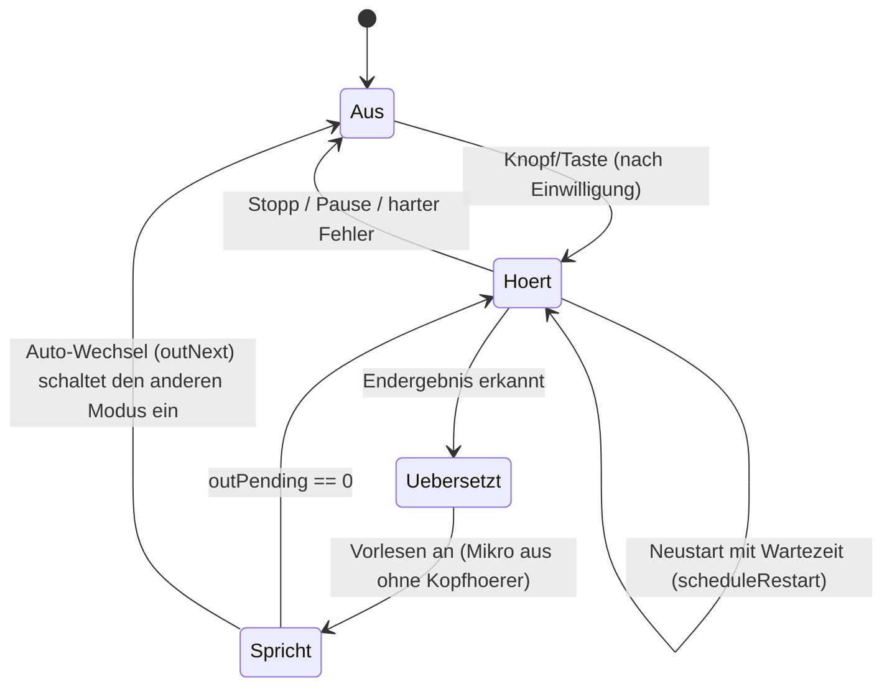

# Architektur

Überblick für Mitwirkende. Das genaue Ereignis- und Einstellungsformat steht in [PROTOKOLL.md](PROTOKOLL.md), welche Daten wohin gehen in [DATENSCHUTZ.md](DATENSCHUTZ.md).

## Prozessmodell

```
┌──────────────────────────┐   stdin: JSON-Zeilen (Einstellungen)   ┌───────────────────────────┐
│ Dolmetscher.app (Swift)  │ ─────────────────────────────────────▶ │ dolmetscher.py --json     │
│  SwiftUI, Menüleiste,    │                                        │  (Python-Prozess, venv)   │
│  Tastenkürzel, L10n      │ ◀───────────────────────────────────── │  Mikrofon → VAD → Whisper │
│  EngineModel (@MainActor)│   stdout: JSON-Zeilen (Ereignisse)     │  → Übersetzung → Stimme   │
└──────────────────────────┘                                        └───────────────────────────┘
```

- Die App ist nur Oberfläche. Sie startet die Engine als Kindprozess und liest stdout zeilenweise. Mikrofon, Erkennung, Übersetzung und Ton gehören der Engine.
- Welches Python (`Paths.swift`, Logik in `EnvLogic.swift`): Dev-Override (`DOLMETSCHER_PYTHON` bzw. Einstellung `DolmetscherPython`) → eigene venv `~/Library/Application Support/Dolmetscher/venv`, aber nur, wenn ihr Stempel `.dolmetscher-stamp` gleich `Contents/Resources/env-stamp` ist (Lock-Hash, Python 3.12, arm64) → sonst Einrichtungs-Bildschirm (`EnvSetup.swift`). Nie `/usr/bin/python3`. Die Info.plist enthält keine Pfade der Bau-Maschine.
- Einrichtung: `setup-env.sh` (aus `build-support/`) mit dem mitgelieferten, signierten `Contents/Helpers/uv`: uv-verwaltetes Python 3.12 nach `…/Dolmetscher/python`, `uv pip sync --require-hashes --no-build` mit dem mitgelieferten `requirements.txt`, Stempel zuletzt. Danach startet die App die Engine, die fehlende Modelle lädt und `download_progress` meldet. Nur Apple Silicon.
- Offline-Übersetzung: `Contents/Helpers/translate-helper` (aus `tools/translate-helper`, Ziel macOS 26.0, Hardened Runtime, eigener Identifier). build.sh überspringt ihn, wenn das SDK fehlt. Die App übergibt ihn ab macOS 26.4 per `--offline-translator` (Einstellung, Standard an); die Engine findet ihn sonst selbst über `../Helpers` neben `Contents/Resources/dolmetscher.py`.
- Bundle-Signatur bleibt heil: die App setzt `PYTHONPYCACHEPREFIX` auf `…/Dolmetscher/pycache`, Hilfsprozesse laufen mit `python -B`.
- Ein Fehler in der Engine stürzt die App nicht ab; die App kann den Prozess beenden und neu starten (`EngineModel.restart()`), etwa wenn sich Startargumente ändern (Mikrofon, Modell, Stimme). Reine Laufzeit-Einstellungen (Tempo, Lautstärke, Sperre auf eine Sprache, Pause) gehen als JSON auf stdin, ohne Neustart.
- Unbekannte JSON-Felder werden auf beiden Seiten ignoriert, so bleiben ältere und neuere Teile kompatibel.
- Dieselbe Engine läuft im Terminal (`python3 dolmetscher.py`), dann ohne `--json` mit Textausgabe.

## Engine: Threads und Pipeline

| Thread / Komponente | Aufgabe |
|---|---|
| Hauptthread (`control_loop`) | liest stdin (Einstellungen, Befehle der App), verarbeitet Aufträge aus der `jobs`-Queue (Erkennen und Übersetzen) |
| `mic-read`, `mic` (`Mic`, `StreamVAD`) | Mikrofon über `avhelper.py` (PyAV/avfoundation, Kindprozess; mit `DOLMETSCHER_FFMPEG` über ffmpeg) lesen, Stille/Sprache erkennen (Silero-VAD), bei Satzende einen Auftrag in die `jobs`-Queue legen |
| `load-*` | Whisper-Modelle parallel laden (`Engine.__init__`) |
| `speaker` (`Speaker`) | Sprachausgabe in eigener Warteschlange; Aufholmodus (schneller sprechen) und Überspringen alter Ausgaben bei Rückstand |
| `tts` (Event-Loop für `edge-tts`), `tts-warmup`, `say-prerender` | Verbindung zur Neural-Stimme schon während des Sprechens öffnen, Fallback `say` vorbereiten |
| `writer` | schreibt bei `--json` die Ereignisse aus einer Warteschlange (2000 Zeilen) nach stdout, damit `emit()` nie blockiert; bei Überlauf fallen zuerst `level`, `partial` und `queue` weg |
| kurzlebige Threads | Aufwärmen von Übersetzung und Thai-Umschrift beim Start |

Ablauf eines Satzes: Mikrofon → VAD (Satzende nach `--silence`) → Sprache bestimmen (Whisper-Wahrscheinlichkeiten, nur zwischen den zwei Sprachen des Paars `--langs`, ggf. Stimmprofil, Sperre `--lang`) → Erkennung (Hauptmodell; das Thai-Modell nur, wenn Thai im Paar ist) → `heard` an die App → Befehlserkennung („Translator, …“, nur mit Englisch im Paar, wird nie übersetzt) → Übersetzung (Claude, sonst Google, sonst MyMemory; weichen Zahlen ab, fragt `recheck_numbers` den jeweils anderen Anbieter) → Ausgabe an den `speaker`. Erkennung und Übersetzung des nächsten Satzes laufen, während der vorige noch gesprochen wird. Die Echo-Sperre verwirft Audio, das während der eigenen Ausgabe plus Nachhall eintrifft.

## Zustände

Es gibt zwei getrennte Zustände, die man nicht vermischen darf:

- **Prozess** (`EngineState` in `app/Engine.swift`): `stopped` → `starting` (Prozess läuft, Modelle laden, bis `ready`) → `running`. Drückt der Nutzer Start, bevor `ready` kam, merkt sich die App den Wunsch und sendet ihn bei `ready`.
- **Äußerung** (je `id`): Platzhalter-Blase bei `thinking` → `utt` mit Text und Übersetzung → `speaking` (nur wenn wirklich Ton kommt) → `speak_done` (genau einmal, auch bei Überspringen oder Abbruch). `dropped` entfernt den Platzhalter. Der Status „spricht“ wird nur über `speaking`/`speak_done` gesetzt, nicht über `listening`.
- Dazu kommen Schalter der Engine: pausiert (die Engine hört weiter auf Befehle), Sprachsperre auf eine Sprache des Paars oder automatisch, Richtungen je Paarsprache einzeln abschaltbar (`tr_mine`/`tr_partner` bzw. `tr_<code>`), stumm. Das Sprachpaar selbst (`langs`: `mine`, `partner`) lässt sich zur Laufzeit wechseln; Standard ist en/th. Die Sprachtabelle `LANGS` in `dolmetscher.py` (19 Sprachen: Name, Schrift, Stimmen, Schwellen, Code für die Übersetzungsdienste) ist die einzige Quelle dafür.

## Dateien

| Datei | Inhalt |
|---|---|
| `dolmetscher.py` | Engine: Mikrofon, VAD, Whisper, Übersetzung, Stimmen, Befehle, JSON-Protokoll |
| `profiles.py` | Stimmprofile (Sprechererkennung per sherpa-onnx), Vokabular-Hinweise |
| `app/*.swift` | SwiftUI-App: `Engine.swift` (Prozess, Ereignisse), `Views`/`BubbleViews`/`SettingsView`, `L10n.swift` (de/en/th), `HotKeys.swift` (globale Kürzel), `PartnerView.swift`, `EnvSetup.swift`/`EnvLogic.swift`/`Paths.swift` (Python-Umgebung), `Languages.swift` (liest `languages.json`), `Presets.swift`, `Profiles.swift`, `AudioOutputs.swift`, `Support.swift` (Export, Diagnose), `Notifications.swift`, `Setup.swift` (Erststart-Checkliste), `Extras.swift` (Kürzel-Rückmeldung, Untertitelfenster), `Runde8.swift` (Fehlerhilfe mit Handlungsvorschlag, Großanzeige, Glossar-Schnelleingabe, Kürzel-Übersicht) |
| `avhelper.py` | Audio über PyAV als Kindprozess (wie früher ffmpeg): `capture` (s16le auf stdout), `play` (mp3 von stdin → AudioToolbox, vorgewärmt), `list` (Mikrofone) |
| `build.sh` | baut `build/Dolmetscher.app` (swiftc, Info.plist, uv + translate-helper + Lock + Stempel + `setup-env.sh` ins Bundle, Signatur von innen nach außen), optional `--install` (beendet eine laufende App vorher) / `--release` |
| `languages.json` | gemeinsame Sprachtabelle (19 Sprachen, Schriften) für Engine, Mac-App und Web; Details und Tests: `tests/test_languages_json.py` |
| `presets/*.json`, `presets.py`, `presets-index.json` | 111 Phrasenpakete (Daten) für Mac, iPhone und Web; Format: [PRESETS.md](PRESETS.md) |
| `history_store.py`, `hwprofile.py`, `correction_learning.py`, `satzbuch.py` | Verlauf (SQLite, optional), Modellwahl `--model auto`, Glossar-Vorschläge aus Korrekturen, Export und Prüfung des Satzbuchs (Kommandozeile) |
| `tools/` | Paket-Werkzeuge (`check_presets.py`, `preset_stats.py`, `export_phrasebook.py`, `make_presets_index.py`, `review_export.py`, `review_import.py`, `review_status.py`), Swift-Quellen von `translate-helper` (kommt ins Bundle) und des Prototyps `apple-stt` |
| `build-support/` | Entitlements, `setup-env.sh` (Einrichtung), `make-stamp.sh` (Stempel) |
| `bench/` | Benchmark für Erkennung und Übersetzung |

## Web Lite (`index.html`)

Eine Datei ohne Build, Skripte nur inline (Content-Security-Policy erlaubt keine fremden Skripte). Zustände:

- `mode` (`null`, `'a'`, `'b'`): wer spricht. `setMode` stoppt Erkennung und Ausgabe, erhöht `gen` und startet `startRec`.
- `gen`: Zähler; verspätete Rückrufe (Übersetzung, Sprachausgabe) vergleichen ihn und verwerfen sich bei Abweichung.
- `outChain` / `outPending` / `outNext`: Übersetzungen laufen parallel, Vorlesen strikt nacheinander in Satzreihenfolge.
- `rec`: laufende `SpeechRecognition`; `pttReleased`: bei „Halten zum Sprechen“ nach dem Loslassen kein Neustart.
- Anbieter-Sicherung `netGuard`: nach zwei Fehlern wird Google bzw. MyMemory 60 s übersprungen.



Weitere Teile: Großansicht (`togglePartner`, History-Eintrag für die Zurück-Taste), Satzbuch (`renderCards`, Pakete aus
`presets/`, Namen aus `presets-index.json`), Lernkarten (Leitner, `localStorage`), Zahlenkarte (`thaiNumber`), Allergiekarte
(`allergens.json`), Oberfläche in drei Sprachen (`STR`, `t()`, `data-i18n`; Deutsch steckt in `index.html`, Englisch und Thai in `i18n/en.json` und `i18n/th.json`, die der Service Worker mit speichert; neue Texte in alle drei eintragen). Reine Logik steht als Top-Level-Funktion, damit
die Tests sie mit node herauslösen können (`tests/_webhelpers.py`).

Grenzen der Sicherheit im Browser: Die Content-Security-Policy steht im `<meta>`, dort wirken `frame-ancestors` und `report-uri` nicht
(Gegenmittel: Frame-Buster am Skriptanfang; mit eigenem Server den Header `frame-ancestors 'none'` setzen, siehe `docs/WEB-HOSTING.md`).
Wegen der Inline-Skripte bleibt `script-src 'unsafe-inline'`: ein XSS-Fund wäre ausführbar, deshalb baut der Code Nutzertext nur
mit `textContent` ein und `innerHTML` nur aus festen Texten. Geteilter Text (`?text=`) wird erst nach Bestätigung an Google gesendet.

Lokal testen: `python3 -m http.server 8000` oder `make web`. Tests: `make test-web` (braucht node). Wer Dateien ändert,
die der Service Worker vorab speichert (`CORE` in `sw.js`), erhöht `CACHE`.

## Demo-Modus (`DOLMETSCHER_DEMO`)

Setzt man die Umgebungsvariable `DOLMETSCHER_DEMO` (irgendein Wert, z. B. `1`) beim Start der App, füllt `EngineModel` den Verlauf mit festen Beispiel-Blasen (Englisch, Thai, unsicher erkannt, übersprungen, Platzhalter). Außerdem startet `boot()` die Engine nicht (`app/Engine.swift` kehrt früh zurück): kein Python-Prozess, kein Mikrofon, kein Netz. Der Modus ist nur für Screenshots und Oberflächentests gedacht. Beispiel:

```bash
DOLMETSCHER_DEMO=1 open -n ~/Applications/Dolmetscher.app   # oder die Binärdatei direkt starten
```

## Tests

`tests/` importiert `dolmetscher.py` direkt, ohne Modelle, Netz oder Mikrofon. `tests/conftest.py` sorgt dafür, dass kein Test ins echte `engine.log` schreibt. Die Mac-App wird in CI typgeprüft und kompiliert; Verträge zwischen App und Engine (Ereignisse, Codes in `docs/PROTOKOLL.md`) prüfen Python-Tests wie `tests/test_app_engine_contract.py`.

## iPhone-App

`ios/Dolmetscher/Round22.swift` ergänzt weitere Reise-Helfer als reine Logik.
`ios/Dolmetscher/Round21.swift` enthält Reise-Helfer als reine Logik (Trinkgeld, Einheiten, Thai-Uhrzeit, Telefonnummer) und das Aufräumen von Export-Dateien.

`ios/` ist eine eigene SwiftUI-App ohne Python-Engine: `AudioCapture` (Mikrofon, Unterbrechungen) speist entweder `AppleSpeechEngine` (SpeechAnalyzer, ein Erkenner je Paarsprache) oder `WhisperSpeechEngine` (WhisperKit, optional). Übersetzung in `Translator.swift` (Apple Translation auf dem Gerät, sonst optional Google/MyMemory), Zustand in `Model.swift`, Sprachen in `Languages.swift`. Reine, testbare Logik steht je Runde in kleinen Dateien: `Round4.swift` (Thai-Zahlwörter, Preise, Auto-Stopp), `Round6.swift` (Zusammenfassung, Kulturhinweis, Sichtschutz, `LivePrivacy`), `Round7.swift` (Barrierefreiheit), `Round8.swift` (Netzwechsel, Lernstatistik, `SecureCopy`, `ShieldPolicy`), `Round9.swift` (Export, Satzbuch-Suche, Unterbrechungen); dazu `Round4Views.swift` (Reise-Vorbereitung, Ziele, Notfall-Bildschirm), `Phrasebook.swift`/`ScenarioPacks.swift` (Satzbuch mit den Paketen aus `presets/`), `Learn.swift` (Lernkarten), `LiveActivity.swift` mit dem Ziel `DolmetscherWidget` (Widgets, Steuerelement), `Intents.swift` (Siri-Kurzbefehle), `L10n*.swift` (zehn Oberflächensprachen). Tastaturkürzel: [TASTENKUERZEL.md](TASTENKUERZEL.md). Bauen und Testen: [ios/README.md](../ios/README.md).
